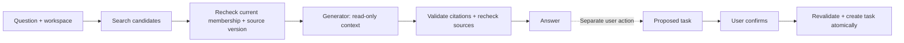

# Source-aware RAG and confirmed actions

[](https://github.com/aistrategyc/source-aware-rag-lab/actions/workflows/ci.yml)

A search index still contains a document after its access was revoked. A generated
answer finishes after the source changed. A user clicks “confirm” twice.

This repository implements the access and transaction boundaries around those
cases. **PostgreSQL full-text search** supplies candidates; canonical records
control what reaches the generator. A proposed task remains inert until an
authorized user confirms it.

The example uses an **extractive, deterministic generator**, not a hosted LLM.
It runs without API keys. It demonstrates retrieval and action controls, not
embedding quality, model reasoning or resistance to every prompt injection.
The related product work is [Planerix ChatIX](https://github.com/aistrategyc/aistrategyc/blob/main/cases/planerix.md).



## Run it

Requires Docker Compose and [uv](https://docs.astral.sh/uv/getting-started/installation/).

```sh
git clone https://github.com/aistrategyc/source-aware-rag-lab.git
cd source-aware-rag-lab
cp .env.example .env
set -a; . ./.env; set +a
docker compose up -d --wait
uv sync --locked
uv run lab demo
uv run pytest
```

The demo retrieves a synthetic delivery runbook, returns a cited extract, records
a proposal, then explicitly simulates user confirmation. Repeating confirmation
returns the same task ID.

## What is implemented

- Search is scoped by workspace and limited to five candidates.
- Source text is loaded from canonical records. Text in the search payload is
  never treated as authoritative context.
- Deleted sources and stale versions are excluded before generation.
- Membership and source versions are checked again before returning the answer.
- A database trigger advances the source version when its content changes.
- Generated citations must refer to the validated context.
- Task proposals bind user, workspace, source version and a ten-minute expiry.
- Confirmation checks current permissions, locks the proposal and commits task
  creation with its acknowledgement.
- Concurrent confirmations create one task.

## Start reading here

| Code | Question it answers |
|---|---|
| [retrieval.py](src/rag_lab/retrieval.py) | Which current source records may this user read? |
| [answer.py](src/rag_lab/answer.py) | What context reaches the generator, and can the answer still be returned? |
| [actions.py](src/rag_lab/actions.py) | Who may confirm which proposed change? |
| [test_rag.py](tests/test_rag.py) | What happens after revocation, deletion, stale retrieval or duplicate confirmation? |

## Replacing the demo generator

`Generator` is a small protocol accepting a question and validated context.
A model adapter can implement it without owning database credentials or action
execution. Treat source text as untrusted content and use structured output for
citations.

A citation ID check cannot establish that a sentence is factually supported.
A real LLM integration still needs groundedness evaluations, prompt-injection
tests, provider timeouts and a data-handling policy. The current extractor simply
quotes the source.

Qdrant or another retrieval engine could replace candidate search; it would not
replace source authorization. No vector service is required or claimed here.

[Design and trust boundaries](docs/design.md) · [Operating notes](docs/operations.md)

By [Kyrylo Prolieiev](https://github.com/aistrategyc) · [Engineering portfolio](https://proleev.com/en) · MIT
