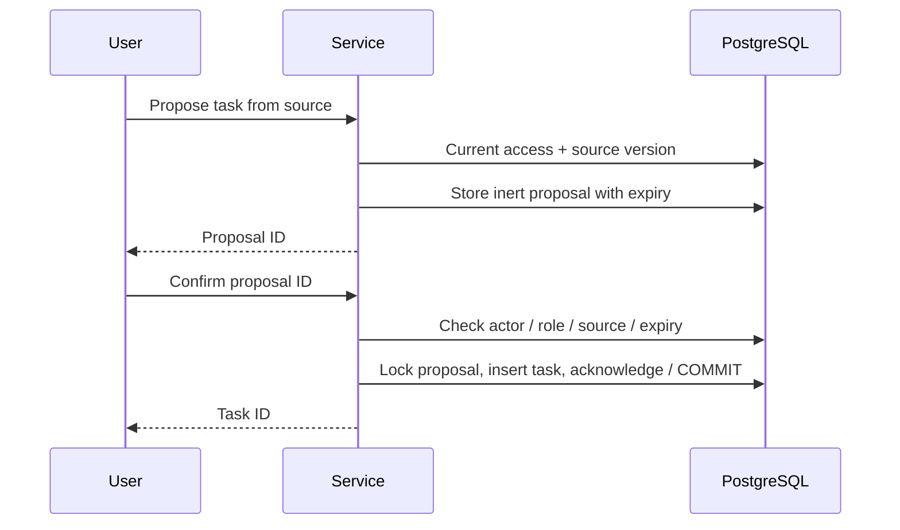

# The index is a locator, not an access-control system

Search indexes are derived data. They can lag behind source edits, deletions and
permission changes. A candidate contains a source ID and version. Revalidation
loads the current source under the requested tenant and current membership.
Missing, deleted or mismatched versions do not enter the context.

This example has workspace-level access. All active workspace members can read
its sources. Per-document grants would require another check at the same source
boundary; they are not implemented here.

## Two checks around generation

The source lookup holds short database locks, then releases them before invoking
the generator. A slow remote model must not hold database transactions open.

After generation, the service rechecks the context set and membership. If a source
changed, the answer is discarded. If access was revoked, the caller gets an
access error.

This does not retract text already sent to a remote provider. If a production
adapter uses one, authorization is evaluated before sending context and again
before returning the answer. Data residency, provider retention and revocation
policy remain deployment decisions.

## Generation has no write capability

The generator receives immutable context values and returns text plus citation IDs.
There is no tool executor in that interface. A source containing “create a task”
can appear as quoted text, but cannot invoke the action service.

Task creation is a separate path:

The same actor must confirm. An editor role and current source version are required.
A retry returns the already created task only after access and source checks.
Expired or stale proposals must be recreated. The client cannot change the title
inside the confirmation request.

## What the tests establish

The tests use real PostgreSQL locks, constraints and full-text search. They inject
model adapters that revoke access, edit a source or return an unknown citation
during generation. The action tests race four confirmations and force an
acknowledgement write failure.

They do not measure relevance, hallucination rate, answer quality or a hosted
provider's behaviour. A deterministic adapter makes the control-flow tests
repeatable; it is not a substitute for model evaluations.

## Next integration boundary

An n8n workflow could request a proposal or notify its owner, but must not turn
model output directly into a privileged operation. An HTTP wrapper needs trusted
identity propagation, rate limits and authenticated confirmation. This repository
exposes Python functions and a local CLI; it does not ship that wrapper or an
n8n connector.
